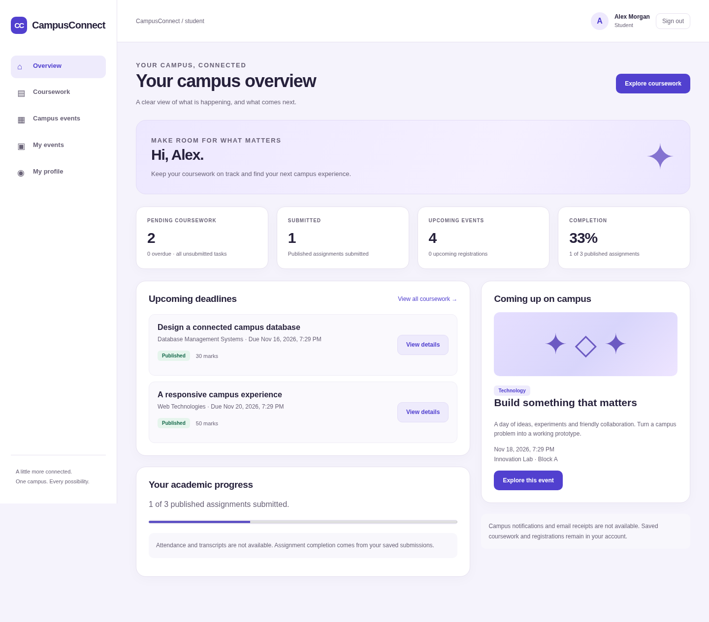

# CampusConnect — enhanced full-stack edition

Campus coursework, submissions, grading, and events using **HTML, CSS, JavaScript, Node.js, Express, MongoDB Atlas/Mongoose, and JWT authentication**.

This is the enhanced implementation. Internal pages use real APIs; sample data is created only by the explicitly selected local demo. See [completion status](docs/PROJECT_COMPLETION_STATUS.md) and [test report](docs/TEST_REPORT.md).



## Open in VS Code

Install Node.js 20+ and Git, then run on your computer:

```sh
git clone https://github.com/AnanyaArora2416/CampusConnect.git
cd CampusConnect
code .
```

If you already cloned the repository, run `git pull` in it instead. If `code` is unavailable, choose **File → Open Folder** in VS Code and select CampusConnect.

Open **Terminal → New Terminal** in VS Code. All commands below run from the project root:

```sh
npm run setup
```

This installs the exact backend dependencies from `backend/package-lock.json`. Root scripts also work with `npm --prefix backend ...` or from inside `backend`.

## Run with your MongoDB Atlas cluster

1. In VS Code Explorer, duplicate `backend/.env.example` and rename the copy **`.env`** inside `backend`.
2. Set `MONGO_URI` privately using Atlas **Connect → Drivers**. Replace username/password placeholders, URL-encode special characters in credentials, and never commit/share the resulting URI.
3. Set `MONGO_DB_NAME=CampusConnect` (or a dedicated development database name).
4. Set `JWT_SECRET` to a random value of at least 32 bytes. Generate one locally with:

   ```sh
   node -e "console.log(require('node:crypto').randomBytes(48).toString('hex'))"
   ```

   Store it in `.env`, not in browser files or Git.

5. In Atlas, ensure the cluster is active, the database user has appropriate access, and **Network Access** allows the machine running Node.js. Keep access scoped to the required outbound IPs.
6. Check connectivity, without changing data or indexes:

   ```sh
   npm run check-db
   ```

7. If that succeeds, start the real app:

   ```sh
   npm start
   ```

8. Open **http://localhost:5000** and keep the server terminal open. The backend serves both UI and API from one origin.

`npm start` **always uses your configured MongoDB**. It does not fall back to demo data. It validates configuration and initializes required indexes before listening. Review existing data/index compatibility before using a live database. No Atlas migration, seeding, account reset or connection verification has been performed by the enhanced implementation.

For the first administrator, run `npm run provision` in an interactive terminal. Confirm `CREATE`, supply the identity, select `admin`, and enter a hidden temporary password. This writes one account to the configured database, never overwriting existing users. Then use **Manage users** to create teachers. Public signup remains student-only.

See [Atlas and connection troubleshooting](docs/ATLAS_SETUP.md).

## Explicit disposable demo — no Atlas

If you only want to try the app locally:

```sh
npm run demo
```

The first run downloads a MongoDB binary. The script creates an isolated local replica set, random JWT secret, sample coursework/events, and temporary uploads. It **does not read `.env`** and **does not connect to Atlas**. It binds to loopback. Stop with Ctrl+C; data is discarded on normal shutdown, and restarting starts over.

| Role    | Local demo email     | Local demo password |
| ------- | -------------------- | ------------------- |
| Student | student@campus.local | CampusDemo2026!     |
| Teacher | teacher@campus.local | CampusDemo2026!     |
| Admin   | admin@campus.local   | CampusDemo2026!     |

These are disposable sample credentials, not real campus/Atlas credentials. Do not expose the demo publicly. Use `DEMO_PORT` to choose a different demo port. Do not run demo and configured app on the same port simultaneously.

## Local browser versus cloud browser

`localhost` refers to the machine running the browser. If Node runs on your computer, use your computer's Chrome. If Node runs inside Codex Cloud, use that environment's shared browser/Desktop or an explicitly provided forwarded preview URL. Typing `localhost:5000` into your own browser does not reach a separate cloud machine.

VS Code has two Run and Debug configurations: **configured MongoDB** and **disposable local demo (no Atlas)**. Use the one you intend; they do not switch automatically.

## Workflows

- **Student:** register → sign in → Coursework → assignment details → final file upload → saved receipt → view grade/feedback. Campus events → register → My events → cancel before the start.
- **Teacher:** create/edit/publish/archive own assignments; attach private resources; review submissions and save grade/feedback. Create, edit, publish/cancel own events and view attendees.
- **Admin:** live campus overview, searchable users, create student/teacher accounts, promote a student to teacher, enable/disable access, manage all assignments/events. Admin identities cannot be changed through the user API.
- **All roles:** edit profile name, change password, and sign out. Password/access changes and sign-out revoke existing sessions on all devices.
- **Operator recovery:** `npm run reset-password` securely prompts for an account and a hidden new temporary password, then revokes sessions after explicit `RESET`. No email recovery service exists.

## Rules

- Students see published non-archived coursework. Teachers see their own; admins see all.
- One final immutable submission per student/assignment. Late uploads are accepted and labelled using the saved server timestamp. No resubmission workflow exists.
- Non-empty PDF/ZIP/DOCX, maximum **25 MiB** per file, at most 10 resources. Content signatures/archive structure are checked. This is not antivirus scanning.
- Private uploads are outside the frontend. Every download checks session and record permissions. Receipts use saved IDs/timestamps; they do not claim email delivery or cryptographic verification.
- Grades range from zero to maximum marks. Archiving hides coursework/downloads while retaining submissions/files for institutional retention.
- Only student accounts register for events. MongoDB transactions and unique indexes enforce capacity and prevent duplicates. Cancellation closes at start time except for cancelled events. Published/cancelled events remain visible; drafts are organizer/admin-only.

## Tests and CI

```sh
npm test
npm run test:browser
```

Tests create local temporary MongoDB replica sets/upload directories and never load `.env` or touch Atlas. Browser tests need Chromium: use `CHROMIUM_PATH`, `/usr/bin/chromium` when present, or install Playwright Chromium from `backend` with `npx playwright install chromium`.

From `backend`, `npm run format:check` checks formatting and `npm audit --omit=dev` audits production dependencies. GitHub Actions runs format, API, and browser checks and retains browser evidence. See the actual results in [TEST_REPORT.md](docs/TEST_REPORT.md); local results do not imply a cloud deployment or Atlas connectivity.

## Deployment

Use HTTPS, Node.js 20+, and a MongoDB replica set (Atlas supports transactions). Install backend dependencies with `npm ci --omit=dev`. Set private environment values, `NODE_ENV=production`, and a persistent private `UPLOAD_DIR`. Back up files and database together. Do not expose private storage as static content. Define file quotas, scanning, retention and orphan reconciliation for institutional production.

Same-origin hosting is recommended. For split hosting, edit `frontend/js/config.js` to your HTTPS API origin and configure `FRONTEND_ORIGINS` for the frontend origins. Never put secrets in browser configuration. The optional `node frontend/dev-server.js` serves port 5500 and calls an API on the same hostname, port 5000.

Authentication throttling uses one in-process store; multiple app instances need a shared limiter store. Configure `TRUST_PROXY_HOPS` only for the exact trusted proxy topology. JWTs remain in sessionStorage; origin scripts can read them. CSP and escaping reduce XSS exposure; an HttpOnly-cookie migration is separate work.

## Documentation

- [Architecture](docs/ARCHITECTURE.md)
- [API reference](docs/API_DOCUMENTATION.md)
- [Database models](docs/DATABASE_MODELS.md)
- [Atlas troubleshooting](docs/ATLAS_SETUP.md)
- [Completion status / limitations](docs/PROJECT_COMPLETION_STATUS.md)
- [Test report](docs/TEST_REPORT.md)
- [Changes](docs/CHANGELOG.md)

Attendance, transcripts, notifications, Google sign-in and email receipts remain explicitly unavailable. The original Figma references are preserved in `docs/figma-designs/`.
