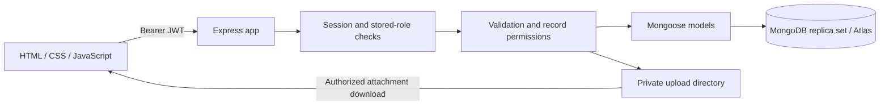

# Architecture

`backend/app.js` builds Express without connecting/listening. `server.js` validates private configuration, connects MongoDB, initializes indexes, then listens. Test/demo entry points do not read `.env` and use isolated local replica sets. There is no automatic demo fallback from configured startup.

Backend modules: `lib/utils.js` provides validation, safe errors, pagination and ownership helpers; `lib/files.js` provides bounded uploads, archive checks, safe serialization and private downloads. Middleware verifies JWTs against active database users. Controllers implement authentication/assignment behavior; routes cover profiles, coursework, submissions, events, administration and summaries.

Internal HTML entry points load `config.js`, `auth.js`, and `app.js` with shared `app.css`. Auth owns token storage, expiry, role routing, API requests and downloads. App renders the selected page with shared forms/navigation/cards/tables/status/dialog components. User/database strings are escaped before HTML insertion. Native dialogs handle receipt focus/Escape. Frontend guards are conveniences; backend independently enforces all permissions.

One-hour HS256 tokens contain user ID and tokenVersion, with fixed issuer/audience. Stored-role lookup prevents browser role escalation. Sign-out, password and access changes increment the database token version, revoking existing tokens. Tokens remain in sessionStorage; origin scripts could read them. CSP, text escaping, no third-party scripts and no inline scripts reduce XSS exposure. HttpOnly-cookie migration requires a separate session/CSRF design.

Event register/cancel transactions update the counter and unique registration together. Conditional capacity updates cannot reduce capacity below registrations. Submissions are insert-only with a unique assignment/student index. Assignment saves use optimistic concurrency to reject stale updates. Archiving retains records/files and hides downloads.

Files are stored under random names outside the frontend. Rejected uploads are removed. Filesystem and database writes are not one transaction: a crash can leave orphan files. Define storage reconciliation, quotas, scanning, retention and backups before institutional production.
